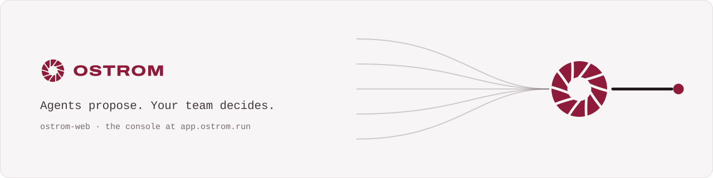
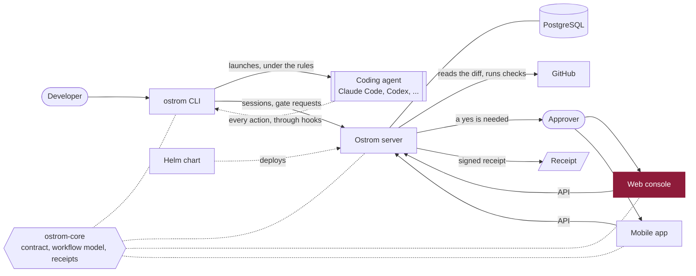

<p align="center">
  <a href="https://ostrom.run">
    <picture>
      <source media="(prefers-color-scheme: dark)" srcset=".github/assets/banner-dark.svg">
      
    </picture>
  </a>
</p>

<p align="center">
  <strong>Ostrom runs a company's AI coding agents in the cloud and makes them follow the team's rules.</strong><br>
  Every change they make leaves a receipt, and the few that matter wait for a person's yes.
</p>

<p align="center">
  <a href="https://ostrom.run">Website</a> ·
  <a href="https://ostrom.run/docs">Docs</a> ·
  <a href="https://github.com/ostrom-hq/ostrom-web/discussions">Discussions</a> ·
  <a href="CONTRIBUTING.md">Contributing</a> ·
  <a href="SECURITY.md">Security</a>
</p>

<p align="center">
  <a href="https://github.com/ostrom-hq/ostrom-web/actions/workflows/ci.yml"></a>
  <a href="CONTRIBUTING.md#tests-the-bar"></a>
  <a href="LICENSE"></a>
  <a href="CHANGELOG.md"></a>
</p>

## What this is

The Ostrom web console, in the cloud or self-hosted: see every agent session, write
the rules your agents follow, answer the gates that wait for a person, and read the receipt of every change. React 19
and TypeScript at the strictest settings, Vite, TanStack Router and Query, Zustand, zod at every boundary.

## Quick start

```sh
git clone https://github.com/ostrom-hq/ostrom-web.git && cd ostrom-web
pnpm install
VITE_MOCKS=true pnpm dev   # http://localhost:5173, the API served by MSW: no server needed
```

## How it fits



## Status

Ostrom is before its first public release. The console is being built: the application shell, the strict toolchain
and the typed API client come first, the screens follow the server routes as they land. Screens that are not built
yet are not shown.

## Commands

```sh
pnpm install
pnpm dev          # http://localhost:5173
pnpm check        # typecheck + lint + format + unit tests (what CI runs first)
pnpm build
pnpm e2e          # Playwright against `pnpm preview`
```

## API contract

Nothing in `src/` writes a route by hand. `pnpm gen:api` generates `gen/api/` from the OpenAPI contract with
hey-api: types, zod schemas (every request and response is validated at runtime), the fetch SDK, TanStack Query
options and typed MSW handlers. CI fails when `gen/` is stale (`pnpm gen:check`).

The contract is the server's OpenAPI document, published by ostrom-server's CI as the npm package
`@ostrom-hq/openapi` on GitHub Packages (ostrom-core `docs/decisions/0001-generated-openapi.md`). `package.json` pins
its version in `ostrom.openapi`; `pnpm gen:api` fetches that version into `.ostrom/openapi.json` (never committed;
`NODE_AUTH_TOKEN`, or `gh auth token` with the `read:packages` scope) and generates from it. A workflow opens a pull
request when a newer version is published. To generate from a local document:
`node scripts/fetch-openapi.ts --from <openapi.json> && pnpm exec openapi-ts`.

`VITE_MOCKS=true pnpm dev` serves the API from MSW (`src/mocks/`, an in-memory server that applies the same
rules as the prototype), so every screen works without a server.

## Architecture

```
src/
  app/        shell, router, providers: the only place that wires features together
  features/   one folder per screen family; a feature exposes its public API in index.ts
  shared/     api client, ui kit, theme, i18n: never imports features/ or app/
  mocks/      MSW handlers and fixtures, wired by app/ in mock mode and by tests
gen/api/      generated from the contract, never edited
ee/           enterprise screens, loaded lazily, never imported statically by src/
```

Rules enforced by the toolchain, not by review:

- `tsconfig.base.json`: `strict`, `noUncheckedIndexedAccess`, `exactOptionalPropertyTypes`,
  `noImplicitOverride`, `noPropertyAccessFromIndexSignature`, `noImplicitReturns`, `verbatimModuleSyntax`,
  `erasableSyntaxOnly`, `noUncheckedSideEffectImports`.
- ESLint: `strict-type-checked` + `stylistic-type-checked`, no `any`, no `@ts-*` comments, no inline
  `eslint-disable` (`noInlineConfig`), exhaustive `switch`, strict boolean expressions, no `enum`,
  explicit return types on exports, jsx-a11y strict, React hooks (compiler rules), and import boundaries
  between `app/`, `features/` and `shared/`.
- Data crossing a boundary (API, `localStorage`, URL) is parsed with zod before the app trusts it.
- Patterns: custom hooks are the ViewModels of screens, Zustand holds local state, TanStack Query holds
  server state. Every string goes through i18n (`en` is the source, `fr` must have the same shape).

## Repositories

| Repository                                                  | What it is                                                                         | License         |
| ----------------------------------------------------------- | ---------------------------------------------------------------------------------- | --------------- |
| [ostrom-core](https://github.com/ostrom-hq/ostrom-core)     | Shared Kotlin Multiplatform library: API contract, workflow model, signed receipts | Apache-2.0      |
| [ostrom-cli](https://github.com/ostrom-hq/ostrom-cli)       | The `ostrom` command line: runs coding agents under the team's rules               | Apache-2.0      |
| [ostrom-server](https://github.com/ostrom-hq/ostrom-server) | The server: gates, receipts, policies, the API                                     | Apache-2.0 + ee |
| **ostrom-web** (this one)                                   | The web console                                                                    | Apache-2.0 + ee |
| [ostrom-app](https://github.com/ostrom-hq/ostrom-app)       | The iOS and Android app                                                            | Apache-2.0 + ee |
| [ostrom-e2e](https://github.com/ostrom-hq/ostrom-e2e)       | Full-stack end-to-end and load tests                                               | Apache-2.0      |
| [ostrom-site](https://github.com/ostrom-hq/ostrom-site)     | ostrom.run: website, documentation, blog                                           | Apache-2.0      |
| [ostrom-helm](https://github.com/ostrom-hq/ostrom-helm)     | Helm chart and Docker Compose for self-hosting                                     | Apache-2.0      |

## Contributing

Contributions are welcome. Read [CONTRIBUTING.md](CONTRIBUTING.md) (setup, tests, Conventional Commits, DCO), the
[Code of Conduct](CODE_OF_CONDUCT.md), and [SECURITY.md](SECURITY.md) to report a vulnerability privately. Questions
go to [Discussions](https://github.com/ostrom-hq/ostrom-web/discussions); help options are in [SUPPORT.md](SUPPORT.md).

## License

Apache License 2.0 ([LICENSE](LICENSE), [NOTICE](NOTICE)), except the `ee/` directory, under the Ostrom Enterprise License ([ee/LICENSE](ee/LICENSE)): you can read, modify and test that code, and running it in production needs an Ostrom Enterprise subscription. Details in [LICENSING.md](LICENSING.md).
